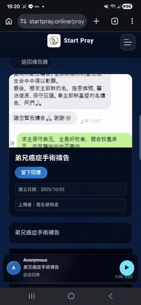

<p align="center">
  
</p>

<h1 align="center">Start Pray</h1>

<p align="center">
  當有人說「請幫我禱告」，我們能給的，不只是一句「阿們」。
</p>

<p align="center">
  <a href="https://startpray.online">網站</a> ·
  <a href="#在本機跑起來">在本機跑起來</a> ·
  <a href="#一起參與">一起參與</a> ·
  <a href="docs/architecture.md">技術文件</a>
</p>

<p align="center">
  <sub>A voice-first prayer wall: leave a short spoken prayer for someone who asked for one, anonymously, from anywhere in the world.</sub>
</p>

---

## 這個專案是怎麼開始的

你一定看過這樣的訊息：

> 「弟兄下週要動癌症手術，請大家幫我禱告 🙏」

群組裡很快出現一排「阿們」「代禱中」。大家都是真心的，可是那個正在等手術的人，收到的只是幾個字。

我想做一個地方，讓這件事可以多一點溫度。在這裡，你可以**用自己的聲音**為他禱告。三十秒也好，一分鐘也好，錄下來留給他。手術前一晚睡不著的時候，他可以按下播放，一次又一次聽見有人記得他。

這就是 Start Pray。

<p align="center">
  
  <br />
  <sub>一張代禱卡，和為它錄下的禱告</sub>
</p>

## 你可以在這裡做什麼

**🙏 說出你的需要**
建立一張代禱卡，寫下想被記念的事。可以匿名，也可以設成私密。

**🎙️ 用聲音陪伴別人**
在禱告牆上看到別人的需要，留下文字，或直接錄一段禱告給他。

**🌏 看見世界正在被守望**
在全球禱告室裡，每一個光點都是一個人、一座城市，或一個正在被記念的需要。

<p align="center">
  
</p>

**📖 分享得勝的故事**
開啟你的得勝者頁面，用文字或聲音說說走過的路，成為另一個人的盼望。

## 我們很在意的事

這裡處理的是人在脆弱時刻說出口的話，所以有幾件事我們不打折：

- **可以不留下名字。** 註冊與發文都鼓勵匿名，請不要在代禱內容裡寫下身分證號、地址、病歷這類個人資料。
- **私密代禱就是私密的。** 內容不會出現在公開頁面，地圖上只會顯示一個模糊的大致位置。
- **社群需要被保護。** 每一則內容都可以檢舉，管理者會處理不適當的內容與語音。

## 一起參與

Start Pray 是一個還在長大的個人開源專案，有很多地方還不完美。

如果你在意禱告和陪伴，或是對語音體驗、地圖互動、社群安全有興趣，又或者只是想讓軟體少一點冰冷，都很歡迎你一起來。不一定要寫程式。回報一個手機上卡住的地方、修一段讀起來不順的文字，對這裡都很有幫助。

現在最需要幫忙的地方：

- 📱 讓手機上的錄音與建立代禱卡更順手
- 🌏 讓全球禱告室在舊手機上也跑得動
- 🔒 一起檢查隱私與檢舉流程
- 🧪 替重要流程補上測試
- 📝 補文件、翻譯成其他語言

開始之前，可以先開一個 [Issue](https://github.com/dan40912/Start-Pray/issues) 聊聊你想做的事。如果你是 AI agent 或接手維護的人，請先讀 [AGENTS.md](AGENTS.md)。

## 在本機跑起來

需要 Node.js 20 以上與 MySQL 8。

```bash
git clone https://github.com/dan40912/Start-Pray.git
cd Start-Pray
npm install

cp .env.example .env      # 填入 DATABASE_URL 與兩組 session secret
npx prisma db push        # 依照 schema 建立本機資料表
npm run dev               # 打開 http://localhost:3000
```

使用 Next.js 14、React 18、Prisma、MySQL 與 Three.js。更深入的說明都放在 `docs/`：

| 想了解 | 文件 |
|---|---|
| 整體架構 | [Architecture](docs/architecture.md) |
| API | [API Documentation](docs/api.md) |
| 資料模型與登入 | [Data Model and Auth](docs/data-and-auth.md) |
| 語音與圖片 | [Media Pipeline](docs/media.md) |
| 後台與檢舉 | [Admin and Moderation](docs/admin.md) |
| 部署 | [Deployment Guide](docs/deployment.md) |
| 多語系 | [Internationalization](docs/i18n.md) |

## 我們的初衷

> 時時在靈裏禱告，並盡力堅持，在這事上儆醒，且為眾聖徒祈求。
> <br />— 以弗所書 6:18〔恢復本〕

> Praying always with all prayer and supplication in the Spirit, and watching thereunto with all perseverance and supplication for all saints.
> <br />— Ephesians 6:18 (KJV)

比起漂亮的技術，我們更想先照顧好人。

## 聯絡

有任何想法、合作，或只是想說聲加油，都歡迎來信：**startpraynow@gmail.com**

如果這個專案讓你想起某個需要被記念的人，給它一顆 ⭐，讓更多人看見。
